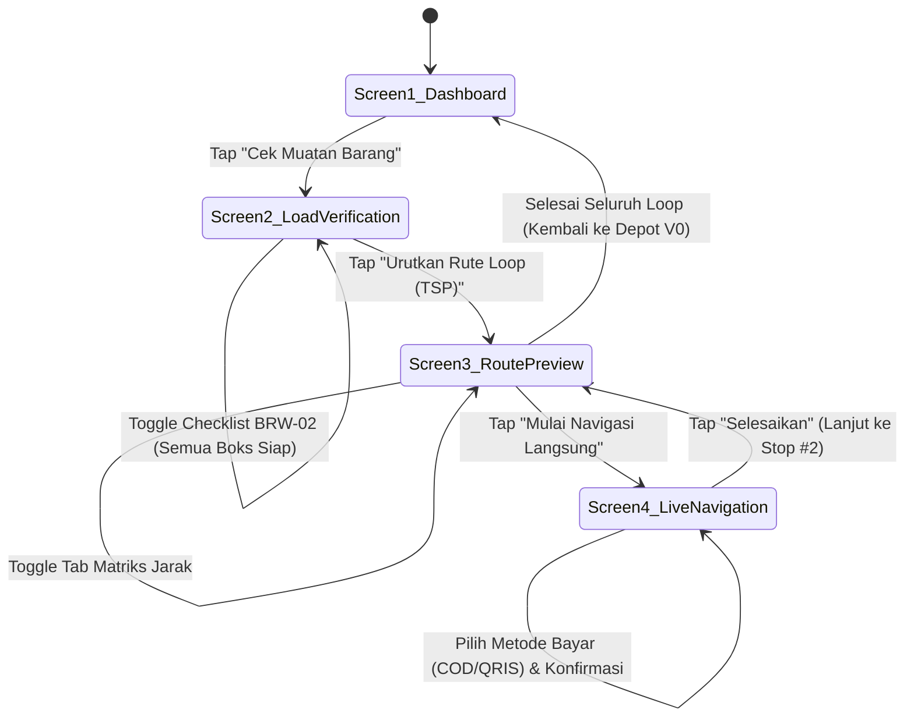

# Spesifikasi Desain UI/UX (Pro Max & Anti-Slop Audit)
## Browcyl Delivery — Sistem Optimasi Rute Pengantaran Tertutup (Closed-Loop TSP)

- **Figma Design File:** [Browcyl Delivery - Final UI (Pro Max)](https://www.figma.com/design/cLq6mInWmssvSCQuaviNpc/Browcyl-Delivery---Final-UI-(Pro-Max))
- **File Key:** `cLq6mInWmssvSCQuaviNpc`
- **Audit Framework:** `ui-ux-pro-max` + `antislop` (Zero AI Slop, Zero Emojis in UI, Purpose-Driven Visuals)
- **Target Platform:** Mobile Native (Android & iOS) — Viewport: `393 × 852 px` (iPhone 14/15/16 Pro)
- **Status:** Production-Ready Design Spec

---

## 1. Hasil Audit Desain: Eliminasi Slop & Peningkatan Pro Max

Dokumen ini merupakan hasil audit komprehensif terhadap spesifikasi desain awal dengan menerapkan dua filter utama:

### 1.1 Temuan Audit Anti-Slop (Yang Dieliminasi & Diperbaiki)
| Elemen Lama (AI Slop) | Masalah / Pelanggaran Aturan | Solusi Anti-Slop (Pro Max Standard) |
| :--- | :--- | :--- |
| **Penggunaan Emoji sebagai Ikon** (`👋`, `📦`, `⚠️`, `✅`, `⚙️`, `🚀`, `📞`, `🟢`) | **Pelanggaran R-01 (No emojis as icons)**. Emoji merusak kredibilitas profesional, inkonsisten antar OS (tampilan beda di Android vs iOS), dan terlihat seperti aplikasi buatan bot murahan. | **100% Geometry Vector Murni (SVG)**: Seluruh ikon diganti dengan path vektor presisi (Box isometrik 3-facet dengan lakban hijau Browcyl, shield warning vektor, panah belok tajam, HUD puck, dan checkmark neon). |
| **Label Teknis Database pada UI** (`Verifikasi Muatan (isDibawa)`) | **Technical Slop**. Nama variabel database (`isDibawa`) bocor ke teks UI, mencerminkan copywriter AI yang malas. | Diganti menjadi copy profesional kurir: **"Verifikasi Muatan Box"** dengan sub-copy: *"Pemeriksaan fisik boks di bagasi motor sebelum memulai rute"*. |
| **Metode Pembayaran Tunggal (COD Saja)** | **Under-specified Requirement**. Realita lapangan toko kue modern membutuhkan fleksibilitas transaksi non-tunai. | Ditingkatkan mendukung **4 Metode Pembayaran**: COD, Cash Tunai, QRIS, dan Transfer Bank, lengkap dengan **Kalkulator Kembalian Otomatis** (*Quick Cash*). |
| **Konteks Spasial Abstrak** | Peta rute generik tanpa nama jalan lokal. | Diperkaya dengan **arteri jalan riil Kota Makassar**: *Jl. A.P. Pettarani*, *Jl. Perintis Kemerdekaan*, *Jl. Antang Raya*, *Jl. Tamangapa*, dan *Jl. Batua Raya*. |

---

## 2. Sistem Desain & Token (Design Tokens)

### 2.1 Palet Warna Kontras Ekstrem (Outdoor Sun Glare Resistance)
Kurir motor beroperasi di bawah terik sinar matahari jalanan Makassar. Desain menggunakan rasio kontras ekstrem **14.5:1** (melebihi standar WCAG AAA 7:1) agar layar tetap terbaca jelas tanpa kurir harus memicingkan mata atau menaikkan kecerahan HP ke level maksimal.

| Kategori Token | Nama Token Kode | Nilai Hex | Peran & Alasan Ergonomis (Purpose Test) |
| :--- | :--- | :--- | :--- |
| **Primary Accent** | `AppColors.electricLime` | `#C6FF00` | **Elemen Aksi Kritis**: Tombol CTA utama, jalur rute aktif di peta, checkmark selesai, dan knob toggle lunas. Memberikan pantulan visual instan di luar ruangan. |
| **Accent Glow** | `AppColors.electricLimeLight` | `#A3E635` | Underglow dan radar pulse trajektori GPS aktif. |
| **Base Surface** | `AppColors.matteCharcoal` | `#18181B` | **Latar Belakang Kontras**: Kartu hero, konsol navigasi, dan bottom sheet. Menghilangkan silau pantulan matahari dibanding latar putih penuh. |
| **Elevated Surface** | `AppColors.darkSecondary` | `#27272A` | Kartu elevasi sekunder, latar tombol aksi cepat (Call/Chat), dan dock navigasi. |
| **Divider & Border Dark** | `AppColors.darkBorder` | `#3F3F46` | Garis hairline pembatas di atas permukaan charcoal. |
| **Light Canvas** | `AppColors.backgroundLight` | `#F8FAFC` | Latar belakang canvas terang saat berada di dalam ruangan / depot. |
| **Card White** | `AppColors.surfaceWhite` | `#FFFFFF` | Permukaan kartu pesanan belum diverifikasi. |
| **Border Light** | `AppColors.borderLight` | `#E2E8F0` | Garis tepi kartu putih (`1.2px solid`). |
| **Status Green** | `AppColors.statusGreen` | `#10B981` | Indikator telemetri GPS Lock dan pembayaran terkonfirmasi lunas. |
| **Status Amber** | `AppColors.statusAmber` | `#F59E0B` | Peringatan inspeksi segel kemasan dan suhu kue (`#FFFBEB` background). |
| **Status Red** | `AppColors.statusRed` | `#EF4444` | Indikator boks belum diverifikasi dan rambu batas kecepatan 40 km/h. |

---

### 2.2 Skala Tipografi (Typography Hierarchy)
Font wajib: **Inter** (atau fallback sistem iOS/Android sans-serif). Zero decorative display fonts.

| Level | Size | Weight | Line Height | Penggunaan Spesifik |
| :--- | :--- | :--- | :--- | :--- |
| `Display Hero` | `28px` | Heavy (`900`) | `115%` | Metrik utama yang wajib dibaca saat berkendara: `"500 M"`, `"5 Box Kue"`. |
| `Page Title` | `24px` | Heavy (`900`) | `120%` | Judul layar: `"Verifikasi Muatan Box"`. |
| `Heading / Name` | `18px` | ExtraBold (`800`) | `125%` | Sapaan `"Halo, Ardiansyah!"`, nama pelanggan `"Ibu Nurul"`. |
| `Section Title` | `16px` | ExtraBold (`800`) | `130%` | Kode pesanan `"BRW-01"`, judul daftar `"Daftar Pesanan Siap Kirim"`. |
| `Button CTA` | `15px` | ExtraBold (`800`) | `100%` | Teks tombol utama di dalam pil hijau lime: `"Urutkan Rute Loop (TSP)"`. |
| `Body / Street` | `12px` | Medium (`500`) | `140%` | Instruksi jalan `"Belok Kanan ke Jl. Antang Raya No. 45"`, SKU brownies. |
| `Caption / Badge`| `10px` | Bold (`700`) | `120%` | Chip telemetri `"GPS Akurat (±3m)"`, badge rute `"V0 • Hub Pettarani"`. |

---

### 2.3 Ergonomi Sentuhan (Touch Targets & Motion)
- **Tombol Utama Bawah (Primary Bottom Action):** Tinggi mutlak **`54px`** dengan sudut penuh (*Full Pill Radius 27px*). Posisi berada di area jempol alami (*Natural Thumb Zone*) agar mudah ditekan satu tangan saat memegang stang motor.
- **Tombol Sekunder (Call / WhatsApp):** Ukuran minimal **`44 × 44 px`** (lingkaran) dengan padding internal yang memadai.
- **Corner Radius:**
  - Kartu: `20px` (modern compact).
  - Bottom Sheet: `32px` (lengkungan kurva halus).
  - Badge / Chip: `999px` (kapsul penuh).
- **Durasi Transisi:** `200ms` s/d `250ms` (*ease-out*) untuk perpindahan status checklist, menghindari animasi lambat yang membuang waktu kurir.

---

## 3. Komponen Desain Reusable (Pro Max Library)

### 3.1 `Comp/Isometric3DBox` (Ilustrasi Boks Kue Vektor)
Bukan icon kardus datar atau emoji. Ilustrasi dibangun dari 3 poligon geometri isometrik:
- **Top Facet:** `#E3BA87` (permukaan atas boks cokelat terang).
- **Left Facet:** `#C79966` (sisi kiri boks dengan bayangan sedang).
- **Right Facet:** `#AB7D4F` (sisi kanan boks dengan bayangan dalam).
- **Lakban Kemasan Khas Browcyl:** Strip segel poligon `#C6FF00` (Electric Lime) melintang di tengah boks untuk pesanan siap kirim.

### 3.2 `Comp/PrimaryLimeButton`
- Auto Layout: Width `353px` (Fill Container), Height `54px`, Radius `27px`.
- Background: `#C6FF00` (Electric Lime).
- Konten: Ikon vektor monokrom `#18181B` di kiri + Teks `15px ExtraBold #18181B`.

### 3.3 `Comp/FloatingNavDock`
- Auto Layout: Width `250px`, Height `50px`, Radius `25px`, Background `#18181B`.
- Tab Aktif: Kapsul `#C6FF00` (Height `38px`, Radius `19px`) berisi ikon vektor rumah + teks `"Home"` tebal.
- Tab Non-Aktif: Ikon vektor garis putih tipis (`stroke-width: 1.6`) untuk Peta, Statistik, dan Profil.

### 3.4 `Comp/RouteNodePin`
- **Simpul Depot ($V_0$):** Lingkaran hitam ganda berdiameter `36px` dengan garis tepi `#C6FF00` (`3px`), ikon gedung depot di tengah, serta lingkaran pulsa luar transparan (`opacity: 0.2`).
- **Simpul Pelanggan ($V_1, V_2$):** Lingkaran hitam berdiameter `32px` dengan border `#C6FF00` (`3px`) dan nomor urutan tebal (`#1`, `#2`) di dalamnya.

---

## 4. Rincian Spesifikasi Layar (Screen-by-Screen Specs)

```
┌──────────────────┐  ┌──────────────────┐  ┌──────────────────┐  ┌──────────────────┐  ┌──────────────────┐  ┌──────────────────┐
│ Screen 0A        │  │ Screen 0B        │  │ Screen 1         │  │ Screen 2         │  │ Screen 3         │  │ Screen 4         │
│ Login Kurir      │➔ │ Registrasi Mitra │➔ │ Dashboard Kurir  │➔ │ Verifikasi Bagasi│➔ │ Preview Rute TSP │➔ │ Live Nav & Kasir │
│ (ID / PIN Cepat) │  │ (Data Armada)    │  │ (Manifest Shift) │  │ (Stack LIFO)     │  │ (Graf Segitiga)  │  │ (HUD & Kasir)    │
└──────────────────┘  └──────────────────┘  └──────────────────┘  └──────────────────┘  └──────────────────┘  └──────────────────┘
```

---

### SCREEN 0A: `Frame_00_Login`
- **Tujuan UX:** Otentikasi identitas kurir operasional Browcyl sebelum mengakses data manifest pengantaran harian.
- **Komponen & Tata Letak:**
  1. **Brand Header (`Background: #18181B, Height: 260px`):**
     - Emblem resmi **KurirGO** 3D isometrik boks Browcyl (`#C6FF00` accent) berukuran `64 × 64 px`.
     - Judul Wordmark: `"KurirGO"` (`26px Heavy #FFFFFF` dengan `GO` miring aksen Electric Lime `#C6FF00`) & Subtitle: `"BROWCYL DELIVERY • MAKASSAR"`.
     - Pill pangkalan: `● Hub Pettarani • Makassar` (`#C6FF00` dot).
  2. **Curved White Form Sheet (`Y: 260px`, Radius Atas `36px`):**
     - Handle drag notch abu-abu.
     - Judul form: `"Masuk Akun Kurir"` & sub-label bantuan.
     - **Field 1 (Username / No. HP):** Ikon user vektor, input box `ardiansyah`, indikator verifikasi hijau.
     - **Field 2 (PIN Akses 4-6 Digit):** Ikon gembok vektor, password dots, dan toggle show/hide eye vektor.
     - **Baris Opsi:** Custom checkbox *"Ingat Perangkat Ini"* & link teks hijau *"Lupa PIN?"*.
     - **Notice Banner:** Latar `#F8FAFC`, ikon info vektor: *"Khusus Mitra & Armada Browcyl: Pastikan GPS aktif saat bertugas."*
     - **Tombol Utama (CTA):** Kapsul penuh Electric Lime `54px`: **`[ Masuk ke Dashboard ]`**.
     - **Switch Registrasi:** Teks bawah *"Belum terdaftar sebagai kurir? Daftar Mitra"*.

---

### SCREEN 0B: `Frame_00_Register`
- **Tujuan UX:** Pendaftaran akun mandiri kurir baru armada Browcyl Makassar tanpa beban data sensitif PII, diperkuat identitas visual KurirGO.
- **Komponen & Tata Letak:**
  1. **Top Nav Header (`Background: #F8FAFC`):**
     - Tombol kembali lingkaran (`40 × 40 px`, panah kiri).
     - Badge peran: `"REGISTRASI KURIR BARU"`.
     - **KurirGO Brand Badge (Top Right):** Pill kapsul charcoal `111 × 34 px` berisi mini emblem isometrik dan wordmark `KurirGO`.
     - Judul: `"Pendaftaran Akun Kurir"` & Subtitle: `"Armada Resmi KurirGO • Browcyl Makassar"`.
  2. **Form Input Container (Streamlined & Privacy-Safe):**
     - **Field 1 (Nama Lengkap):** Input teks `Ardiansyah Pratama`.
     - **Field 2 (Username Akun - Opsi A):** Input teks `ardiansyah` + badge status hijau `● Tersedia`.
     - **Field 3 & 4 (PIN Akses & Konfirmasi):** 2 kolom sejajar (PIN baru 4-6 digit & Konfirmasi PIN dengan indikator match checkmark).
     - **Field 5 (Pilihan Hub Pangkalan):** Chip selector: `● Hub Pettarani (Active)`, `Hub Perintis`, `Hub Antang`.
     - **Field 6 (Nomor WhatsApp / HP - Opsional):** Input `0812-4567-8901 (Bisa dikosongkan)` untuk verifikasi OTP / kontak darurat.
     - **Checkbox SOP:** *"Saya menyetujui SOP Higienitas & Pengantaran Browcyl (Penyusunan Bagasi LIFO & Penjagaan Kualitas Kue)"*.
  3. **Bottom Action:**
     - **Tombol Utama (CTA):** Kapsul Electric Lime `54px`: **`[ Daftar Akun KurirGO ]`**.
     - **Switch Login:** *"Sudah punya akun kurir? Masuk di sini"*.

---

### SCREEN 1: `Frame_01_Dashboard`
- **Tujuan UX:** Orientasi awal kurir saat tiba di Hub Depot Pettarani: mengetahui siapa yang bertugas, beban total, dan daftar boks yang harus disiapkan.
- **Komponen & Tata Letak:**
  1. **Top Status Bar & Dynamic Island (`Y: 12px`):**
     - Dynamic Island (`112 × 28 px`, hitam).
     - Indikator sinyal 5G, indikator baterai, dan dot hijau telemetri `● GPS Lock`.
  2. **Profil Kurir Ardiansyah (`Y: 70px`):**
     - Avatar kurir berkaos charcoal dengan topi hijau Browcyl (`#C6FF00`).
     - Teks `"Halo, Ardiansyah!"` (`18px ExtraBold #18181B`) dan sub-label `"Hub Pettarani • Makassar"`.
     - Badge pengalaman: Kapsul abu-abu dengan ikon boks mini vektor: `"Kurir Browcyl (5 Thn)"`.
     - **KurirGO Brand Badge (Top Right):** Pill kapsul `111 × 34 px` berisi mini emblem dan wordmark `KurirGO`.
  3. **Hero Workload Card (`Y: 130px`, Height `156px`, Radius `22px`, Background `#18181B`):**
     - Badge kapsul header: Dot hijau + teks `"RUTE HARI INI"`.
     - Stat Utama: `"5 Box Kue"` (`28px Heavy #FFFFFF`).
     - Sub-stat: `"3 Alamat Pengantaran • Kembali ke Depot (V0)"` (`12px Medium #A1A1AA`).
     - Vektor kurva elevasi rute bercahaya (*glowing path*) berwarna `#C6FF00` dengan titik glow di ujung kanan.
  4. **Daftar Pesanan Siap Kirim (`Y: 318px`):**
     - Section Header: `"Daftar Pesanan Siap Kirim"` di kiri dan `"Lihat Semua (2)"` di kanan.
     - **Card 1 (`BRW-01`):** Latar putih, boks 3D isometrik dengan lakban hijau, kode `"BRW-01"`, rincian `"3 Box (Unti & Cokelat)"`, rute `"Cab. Sudiang • 12.5 KM dari Depot"`, pill tag `"Belum Disortir"`.
     - **Card 2 (`BRW-02`):** Latar putih, boks 3D isometrik, kode `"BRW-02"`, rincian `"2 Box (Choco Banana)"`, rute `"Cab. Antang • 5.2 KM dari Depot"`, pill tag `"Belum Disortir"`.
  5. **Bilah Navigasi & Tombol Aksi Bawah:**
     - `Comp/FloatingNavDock` di `Y: 694px`.
     - `Comp/PrimaryLimeButton` di `Y: 760px`: Ikon paket vektor + teks `"Cek Muatan Barang"`.

---

### SCREEN 2: `Frame_02_VerifikasiMuatan`
- **Tujuan UX:** Menjamin tidak ada kue yang tertinggal dan memvalidasi susunan bagasi motor kurir sesuai urutan bongkar muat LIFO.
- **Komponen & Tata Letak:**
  1. **Header Hitam Atas (`Background: #18181B, Height: 194px`):**
     - Tombol kembali lingkaran (`40 × 40 px`, background `#27272A`, panah vektor putih).
     - Badge status: `"TAHAP 1: VERIFIKASI"`.
     - Judul: `"Verifikasi Muatan Box"` (`24px Heavy #FFFFFF`).
     - Subtitle: `"Periksa boks fisik di bagasi motor sebelum memulai rute"`.
     - Kapsul ringkasan: Dot hijau + teks `"Total 5 Box • 2 Alamat"`.
  2. **Curved White Bottom Sheet (`Y: 194px`, Radius Atas `32px`):**
     - Handle notch drag abu-abu (`40 × 4 px`).
     - **Notice Banner Inspeksi (`Y: 222px`):** Background kuning pastel `#FFFBEB`, border `#FDE68A`, ikon perisai/warning vektor, teks *"Pemeriksaan Fisik Bagasi Kurir: Pastikan segel box utuh dan temperatur kemasan terjaga."*
     - **Card 1 (`BRW-01` - Terverifikasi):** Background Matte Charcoal `#18181B`, boks 3D dengan lakban hijau, detail kue Unti & Cokelat, tag `"Outlet Sudiang (V1)"`, tombol centang aktif lingkaran `#C6FF00` dengan tick tebal.
     - **Card 2 (`BRW-02` - Belum Dicentang):** Background putih border `#E2E8F0`, detail Choco Banana, tag `"Outlet Antang (V2)"`, kotak checkbox kosong bertepi abu-abu siap tekan.
     - **Alert Banner Peringatan (`Y: 496px`):** Background merah pastel `#FEF2F2`, border `#FEE2E2`, ikon seru bulat merah vektor: *"1 Pesanan Belum Terverifikasi: Centang BRW-02 untuk mengaktifkan kalkulasi rute loop."*
     - **Kartu Edukasi Algoritma (`Y: 562px`):** Menjelaskan optimasi TSP dan penguncian rute pulang ke depot $V_0$.
     - **Tombol Aksi Utama (`Y: 760px`):** Ikon graf rute vektor + teks `"Urutkan Rute Loop (TSP)"`.

---

### SCREEN 3: `Frame_03_RuteGraph_Preview`
- **Tujuan UX:** Menampilkan representasi graf berbobot hasil kalkulasi algoritma TSP (Held-Karp) dan membuktikan efisiensi jarak tempuh kepada kurir.
- **Komponen & Tata Letak:**
  1. **Peta Interaktif Arteri Makassar (`Height: 520px`):**
     - Grid jalan raya realistis: Jl. A.P. Pettarani, Jl. Perintis Kemerdekaan, Jl. Antang Raya, Ring Road Tamangapa.
     - Tombol kembali lingkaran putih melayang di pojok kiri atas.
     - **Route Metric Floating Pill (`Y: 54px`):** Kapsul hitam Charcoal dengan teks `"28.5 KM (Full Loop) • 1 Jam 10 Mnt"` dan badge hemat BBM `"-32% BBM"`.
     - **Closed-Loop Route Geometry:** Garis segitiga melingkar tebal dengan underglow hijau lime menyala (`opacity: 0.35`) dan garis inti kontras tinggi menghubungkan $V_0 \to V_2 \to V_1 \to V_0$.
     - Panah penunjuk arah alur di setiap segmen rute.
     - Badge jarak pada sisi graf: `8.2 KM` (Pettarani ke Antang), `12.3 KM` (Antang ke Sudiang), `8.0 KM` (Sudiang ke Pettarani).
     - Simpul $V_0$ (Hub Pettarani) berpulsa radar hijau lime, simpul $V_2$ (#1 Antang), dan simpul $V_1$ (#2 Sudiang).
     - Tombol Recenter GPS target vektor di kanan bawah peta.
  2. **Charcoal Bottom Sheet (`Y: 468px`, Radius Atas `32px`, Background `#18181B`):**
     - Notch bar abu-abu.
     - **Segmented Control Tab:** Tab aktif hijau lime `"Urutan Rute Loop (TSP)"` vs tab non-aktif `"Detail Jarak (KM)"` (menampilkan Adjacency Matrix).
     - **Timeline Manifest Pengantaran:**
       - Titik 1: Dot hijau neon ganda ➔ `STOP #1 ➔ V2 (Outlet Antang)` • 2 Box • 8.2 KM • Est. 10:15 WITA.
       - Garis putus-putus penghubung antrean.
       - Titik 2: Dot abu-abu border hijau ➔ `STOP #2 ➔ V1 (Outlet Sudiang)` • 3 Box • 12.3 KM • Est. 10:45 WITA.
       - Titik 3: Dot putih ➔ `FINISH ➔ Kembali ke Depot Pettarani (V0)` • 8.0 KM • Est. 11:20 WITA.
     - **Tombol Aksi Utama (`Y: 760px`):** Ikon panah navigasi vektor + teks `"Mulai Navigasi Langsung"`.

---

### SCREEN 4: `Frame_04_LiveNavigation_InApp`
- **Tujuan UX:** Konsol kemudi kurir saat berkendara: navigasi belokan jalan riil, informasi pelanggan, pengelolaan multi-pembayaran (COD/QRIS/Transfer/Cash), dan penyelesaian trip.
- **Komponen & Tata Letak:**
  1. **Top Floating Turn HUD Banner (`Y: 52px`, Radius `22px`, Background `#18181B`):**
     - Panah belok kanan tebal bercahaya Electric Lime (`#C6FF00`).
     - Teks target: `"STOP #1 DARI 2 • OUTLET ANTANG"` (`10.5px Bold #C6FF00`).
     - Teks jarak besar: `"500 M"` (`28px Heavy #FFFFFF`) & estimasi waktu `"Est. 2 mnt"`.
     - Instruksi belokan: `"Belok Kanan ke Jl. Antang Raya No. 45"`.
     - Telemetri GPS tag: Dot hijau + teks `"GPS Akurat (±3m) • 38 km/h"`.
  2. **Live Map Trajectory Canvas:**
     - Jalur rute menyala hijau lime di Jl. Antang Raya menuju pin tujuan Stop #1 (Outlet Antang).
     - **Courier GPS Puck:** Lingkaran konsentris pulsa radar hijau lime transparan dengan panah orientasi heading menghadap 32° timur laut.
     - Rambu batas kecepatan jalan: Lingkaran putih border merah tebal bertuliskan `"40"`.
     - Tombol kompas & re-center GPS.
  3. **Bottom Courier Interaction Console (`Y: 556px`, Radius Atas `32px`, Background `#18181B`):**
     - Notch bar drag console.
     - **Bagian Info Pelanggan:**
       - Avatar inisial `"IN"` bulat.
       - Teks `"Ibu Nurul (Outlet Antang)"` (`15px ExtraBold #FFFFFF`) dan SKU `"BRW-02 • 2 Box (Choco Banana Melt)"`.
       - Tombol aksi cepat: Tombol Call lingkaran telepon vektor + Tombol Chat/WhatsApp lingkaran vektor.
     - Garis divider hairline `#27272A`.
     - **Bagian Pembayaran Multi-Metode & Kasir:**
       - Ikon uang/bill vektor.
       - Label tagihan: `"Tagihan COD: Rp 150.000"` (dengan opsi Quick Change Calculator).
       - Status badge hijau: `"● Pembayaran Terkonfirmasi Lunas"`.
       - Active iOS-Style Toggle Switch: Latar kapsul `#C6FF00` dengan knob hitam dan tick centang hijau di dalam knob.
     - **Tombol Aksi Utama (`Y: 760px`):** Ikon lingkaran checkmark vektor + teks `"Selesaikan & Lanjut ke Stop #2 (Sudiang)"`.

---

### SCREEN 5: `Frame_05_RiwayatPengantaran`
- **Tujuan UX:** Rekonsiliasi setoran kasir depot dan laporan riwayat pengantaran kurir setelah menyelesaikan seluruh rute pengantaran tertutup (*Closed-Loop TSP*).
- **Komponen & Tata Letak:**
  1. **Top Nav Header (`Background: #18181B`):**
     - Tombol kembali lingkaran (`40 × 40 px`, panah putih).
     - Badge alur: `"PENGANTARAN SELESAI"`.
     - KurirGO Brand Badge (kanan atas) kapsul charcoal `111 × 34 px`.
     - Judul: `"Riwayat Pengantaran"` & Subtitle `"2 Pesanan Selesai • Hub Pettarani • 15 Nov 2026"`.
  2. **Hero Cashier Settlement Card (`Y: 156px`, Radius `20px`, Background `#202024`):**
     - Tag: `"SETORAN KASIR DEPOT"` dengan ikon dompet/uang vektor.
     - **Kolom Kiri (Tunai / COD Wajib Setor):** Angka besar `"Rp 150.000"` (`#C6FF00`), dot kuning `"● 1 Pesanan (Fisik di Tas)"`.
     - Divider vertikal `#2E2E33`.
     - **Kolom Kanan (Non-Tunai QRIS/Transfer):** Angka besar `"Rp 225.000"` (`#FFFFFF`), dot hijau `"● 1 Pesanan (Masuk Rekening)"`.
     - Pill rekap bawah: Total Omzet `"Rp 375.000 (2 Pesanan)"`.
  3. **Trio Metrik Efisiensi Rute (`Y: 304px`):**
     - Kapsul 1: `"5 Box (100%)"` kue terantar.
     - Kapsul 2: `"28.5 KM"` total jarak loop selesai.
     - Kapsul 3: `"-32% BBM"` efisiensi algoritma TSP Held-Karp.
  4. **Timeline Rincian Pengantaran (`Y: 396px`):**
     - **Kartu Stop #1 (10:15 WITA):** Ibu Nurul (Outlet Antang), 2 Box Choco Banana, badge `COD Rp 150.000`, status `Lunas Tunai`.
     - Garis track penghubung putus-putus.
     - **Kartu Stop #2 (10:45 WITA):** Bpk. Rahmat (Outlet Sudiang), 3 Box Unti & Cokelat, badge `QRIS Rp 225.000`, status `Terverifikasi`.
     - Garis track penghubung.
     - **Kartu Finish (11:20 WITA):** Kembali ke Hub Depot Pettarani ($V_0$), status `Loop Tertutup Selesai • Bagasi Kosong`.
  5. **Tombol Aksi Bawah (`Y: 736px`):**
     - Kapsul penuh Electric Lime `54px`: **`[ Setor Tunai ke Kasir Depot ]`** dengan ikon tanda terima/kwitansi kasir.

---

### SCREEN 5B: `Frame_05B_StatistikPerforma`
- **Tujuan UX:** Dashboard kinerja shift dan produktivitas kurir operasional (Tab 3 pada Floating Nav Dock) yang menyajikan metrik nyata yang dibutuhkan kurir: total boks terantar, ringkasan jam bertugas, volume pengantaran 7 hari, dan uang fisik/non-tunai yang diterima pada shift ini.
- **Komponen & Tata Letak:**
  1. **Top Nav Header (`Background: #F8FAFC`):**
     - Tombol kembali lingkaran (`40 × 40 px`), BrandBadge KurirGO, judul `"Performa Kurir"`.
  2. **Hero Kinerja Shift Kurir (`Y: 106px`, Matte Charcoal `#18181B`, Radius `22px`):**
     - Tag: `"RINGKASAN SHIFT HARI INI"` dengan dot hijau `#C6FF00`.
     - Metrik Utama: `"5 Box Selesai"` • `"2 Alamat Pengantaran Tuntas"`.
     - Subtitle: `"Semua pesanan berhasil diantar tepat waktu & kondisi boks aman 100%"`.
     - Rincian Operasional: Total Jarak `28.50 KM`, Waktu Bertugas `1 Jam 10 Mnt`, Status Shift `Tuntas (100%)`.
  3. **Grafik Batang Boks Terantar Minggu Ini (`Y: 272px`, Card Putih `#FFFFFF`):**
     - Diagram batang volume harian Sen s/d Min dengan highlight Electric Lime `#C6FF00` untuk hari ini.
     - Total mingguan: `177 Boks` (Pencapaian target harian stabil).
  4. **Rekapitulasi Uang Diterima Shift Ini (`Y: 480px`, Total `Rp 375.000`):**
     - Rincian uang fisik COD: `"Rp 150.000"` (Dipegang kurir • Wajib setor ke kasir depot).
     - Pembayaran non-tunai QRIS/Transfer: `"Rp 225.000"` (Langsung masuk rekening Browcyl • Auto lunas).
  5. **Indikator Kualitas Layanan (`Y: 606px`):**
     - `"98.4% Tepat Waktu"` (Ketepatan jam kirim) & `"100% Box Utuh"` (Kondisi paket sempurna).
  6. **Floating Nav Dock (`Y: 694px`):**
     - Tab 3 (Performa) **AKTIF** dengan kapsul `#C6FF00` dan teks `"Performa"`.

---

### SCREEN 6: `Frame_06_ProfilKurir`
- **Tujuan UX:** Pusat informasi profil mitra kurir operasional Browcyl Makassar (Tab 4 pada Floating Nav Dock), data legalitas armada kendaraan, kepatuhan SOP higienitas LIFO, dan kontak darurat Hub.
- **Komponen & Tata Letak:**
  1. **Top Nav Header (`Background: #F8FAFC`):**
     - Tombol kembali lingkaran (`40 × 40 px`), BrandBadge KurirGO, judul `"Profil Mitra Kurir"`.
  2. **Courier Identity Card (`Y: 106px`, Matte Charcoal `#18181B`, Radius `22px`):**
     - Avatar kurir dengan topi hijau Browcyl & border Electric Lime.
     - Nama: `"Ardiansyah Pratama"` • ID: `"BRW-KRR-042"`.
     - Status: `"Hub Pettarani • Makassar (Aktif)"`.
     - Trio Metrik Kurir: Rating `4.95 ★`, Total Antar `1.240 Boks`, Pengalaman `5 Tahun`.
  3. **Data Armada & Perizinan Motor (`Y: 292px`, Card Putih `#FFFFFF`):**
     - Kendaraan terdaftar: `Yamaha NMAX 155 (DD 4582 XY)`.
     - SIM C Kepolisian RI: `Valid s/d 14 November 2028 (Aktif)`.
  4. **Kepatuhan SOP Browcyl Makassar (`Y: 440px`, Card Putih `#FFFFFF`):**
     - `[✓] Muat LIFO Bagasi Motor` (Tujuan pertama di posisi paling atas bagasi).
     - `[✓] Suhu Kemasan & Segel Utuh` (Suhu stabil 24°C, lakban segel kue tidak koyak).
     - `[✓] Setor Kasir Tunai COD Selesai Rute` (Uang fisik diserahkan tepat waktu di Hub).
  5. **Tombol Tindakan Cepat (`Y: 606px`):**
     - Tombol `"Hubungi Hub"` (Telepon/WhatsApp koordinator depot).
     - Tombol `"Keluar Akun"` (Merah lembut `#EF4444`).
  6. **Floating Nav Dock (`Y: 694px`):**
     - Tab 4 (Profil) **AKTIF** dengan kapsul `#C6FF00` dan teks `"Profil"`.

---

## 5. Alur Navigasi & Prototyping State Machine



1. **State 1 (Dashboard):** Tombol CTA membuka layar verifikasi muatan.
2. **State 2 (Verifikasi Muatan):** Validasi boks bagasi motor. Tombol rute terkunci selama masih ada boks belum dicentang.
3. **State 3 (Route Preview):** Menampilkan solusi TSP Held-Karp $V_0 \to V_2 \to V_1 \to V_0$. Tombol navigasi mengaktifkan mode kemudi.
4. **State 4 (Live Navigation):** Pemanduan jalan raya real-time dan penyelesaian transaksi pembayaran pelanggan.


## Phase 4 — Final UI decisions

Use the latest seven-screen contract in PRD and ARCHITECTURE. All screens use
charcoal/lime with Material Icons (no emoji), Inter/system sans-serif, 54px
minimum full pill CTAs (radius 27), 20px cards and keyboard-safe scrolling forms.
The verification warning has an amber background and dark text. Route diagrams
use the agreed coordinates and directed 8.2/12.3/8.0 km loop, not street geometry.

Navigation HUD/GPS/speed and QRIS are explicitly simulated. The old -32% BBM
badge is replaced by computed distance comparison (0% for the current fixture).
History has exactly three metrics: Boks Terantar (5 Box / 100%), Total Jarak
(28.5 KM), Waktu Tempuh (1 Jam 10 Mnt, fixture estimate). Metrics wrap and grow
vertically; do not clip them inside single-line Chips. Cash/noncash totals are
dynamic from completed orders. The depot finish remains pending until the
courier confirms return and cash handover. No shift jargon appears in product UI.

Design Read: mobile courier tool for Browcyl Makassar; matte operational surfaces,
ENERGY 2 / RHYTHM 2 / MOTION 1. Lime marks the next action and active route;
stack order and a closed triangle provide the recurring product motif. Transitions
respect reduced motion; forms/summary can scroll at increased text sizes.


## Revisi navigasi interaktif (16 November 2026)

- OSM menjadi peta dasar interaktif; rute mengikuti geometri jalan OSRM tersimpan.
  HUD, kontrol peta dan kasir mempertahankan Charcoal/Lime dari Frame 04.
- Inter dibundel lokal. Dashboard memakai F8FAFC, kartu pesanan putih,
  Emerald 047857 untuk status pada permukaan terang, inspeksi pastel FFFBEB.
- HUD diberi label Simulasi 20x, dengan akurasi simulasi +/-3 m. Kecepatan
  36-42 km/jam saat berjalan dan nol saat jeda/tiba. Posisi bukan pembacaan GPS.
- Recenter mengunci kamera tanpa mereset progres; gerakan peta manual melepas
  penguncian. Fokus kamera berada di bawah HUD, termasuk pada teks 1,6x.
- CTA minimum 54px/radius 27 dapat bertambah tinggi saat teks membungkus.
  Kartu pesanan dan mini stepper membungkus teks pada 320px tanpa mengecilkan font.
- Peta selalu menampilkan atribusi OpenStreetMap. Jika tile gagal dimuat,
  geometri tersimpan dan kontrol tetap berfungsi, disertai pemberitahuan.
- Teks 28,5 km adalah matriks akademis; geometri jalan tersimpan sekitar
  40,93 km. Estimasi 1 Jam 10 Mnt tetap estimasi fixture, bukan hasil pengukuran.
- Ikon QRIS adalah contoh simulasi dan tidak dapat menerima pembayaran.

## Frame 06B — Ubah Profil Mitra Kurir (16 November 2026)

- **Tujuan Layar:** Mengelola identitas mitra kurir di lapangan (foto berseragam Browcyl, nama lengkap, nomor WhatsApp aktif, alamat domisili zona hub, serta kontak darurat). Data privat sensitif seperti plat motor dan SIM sengaja tidak diekspos di aplikasi harian kurir untuk keamanan data mitra.
- **Header:** Circle back button `<-`, title `Ubah Profil Kurir`, official BrandBadge `KurirGO`.
- **Hero Uploader:** Kartu foto profil terpusat (diameter 72px) dengan topi/seragam Browcyl, cincin aksen `#C6FF00`, dan floating badge kamera untuk mengganti foto profil (format JPG/PNG/WebP maks. 5MB).
- **Field Kemitraan:**
  - `ID Mitra Kurir`: Terkunci (Read-Only) `BRW-KRR-042` ke Hub Pettarani.
  - `Nama Lengkap`: Input field aktif dengan verifikasi checkmark.
  - `Nomor WhatsApp`: Nomor kontak pemesan & dispatcher dengan badge verifikasi OTP.
  - `Alamat Domisili`: `Panakkukang, Kota Makassar` dengan badge zona penugasan `Zona Timur / Hub Pettarani`.
  - `Kontak Darurat`: Nomor keluarga/kerabat terdekat di Makassar saat bertugas.
- **Action Buttons:**
  - Primary CTA (52px pill): `Simpan Perubahan Profil` (Electric Lime `#C6FF00`).
  - Secondary CTA (42px pill): `Batal & Kembali ke Profil`.
- **Integrasi Prototype:** Terhubung dua arah dari `BtnUbahProfil` di `Frame_06_ProfilKurir` dengan transisi `Slide in Left` / `Smart Animate`.

## Implementasi FigCraft — 16 November 2026

Acuan lokal: `design/KurirGO_Final_UI.figcraft`, disalin dari dokumen KurirGo
terbuka di FigCraft. Logo asli diekspor dari node 425 (512×512) dan 447
(540×140), pada skala 2, ke `assets/brand/`. Logo login dirender 64×64 tanpa
mengubah rasio. Font Inter tetap dibundel; dokumen impor mengubah teks menjadi
vektor sehingga nama font sumber tidak dapat diverifikasi.

Arah implementasi: ENERGY 2 / RHYTHM 2 / MOTION 1. Charcoal mengelompokkan
ringkasan rute dan uang setoran, putih untuk isi/form, lime untuk aksi utama dan
tujuan aktif. Pola tertutup dan logo K menjadi identitas, tanpa animasi baru.

Riwayat memakai permukaan terang dengan kartu setoran charcoal. Dashboard
memiliki tab Home/Performa/Profil. Layar Performa menggunakan data rute sesi ini;
tidak menampilkan rating atau riwayat mingguan contoh sebagai data sungguhan.
Profil dan Ubah Profil mendukung nama serta WhatsApp dengan validasi, tersimpan
di akun lokal dalam memori. Avatar/foto, OTP, alamat, kontak darurat, dan ID
kemitraan pada mockup belum memiliki implementasi layanan atau data; belum
ditambahkan sebagai kontrol. Karena itu hasil bukan salinan penuh seluruh
fitur mockup. Map, sumber tile, geometri rute dan simulasi dipertahankan.
